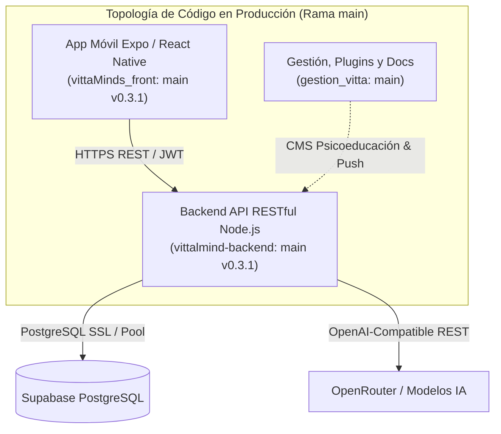
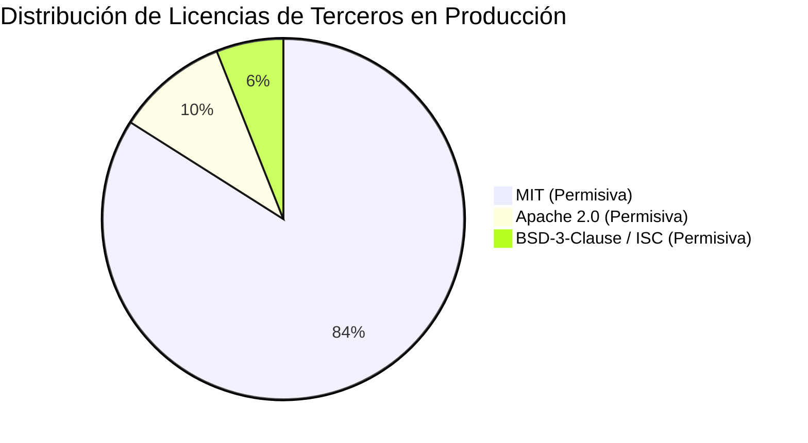
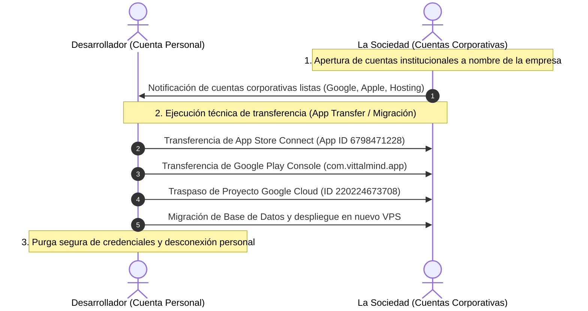

# ACTA DE ENTREGA INICIAL E INVENTARIO INTEGRAL DE ACTIVOS TECNOLÓGICOS, PROPIEDAD INTELECTUAL E INFRAESTRUCTURA (RAMA MAIN / PRODUCCIÓN)

**PROYECTO:** VittalMind — Sistema de Salud Mental y Bienestar Emocional  
**ALCANCE:** Versión en Producción (Rama `main`)  
**FECHA DE ENTREGA:** 25 de Octubre de 2026  
**ENTREGA REALIZADA POR:** EL DESARROLLADOR / CEDENTE  
**ENTREGA RECIBIDA POR:** LA SOCIEDAD / CESIONARIA  

---

## 1. COMPARECIENTES Y OBJETO DEL ACTA

En la fecha indicada, comparecen por una parte **EL DESARROLLADOR** (en adelante, el "CEDENTE"), autor de la arquitectura, diseño técnico y código fuente del sistema VittalMind; y por la otra parte el Representante Legal de **LA SOCIEDAD** (en adelante, la "CESIONARIA"), con el fin de formalizar el **ACTA DE ENTREGA INICIAL** y el **INVENTARIO INTEGRAL DE ACTIVOS TECNOLÓGICOS, CÓDIGO FUENTE, INFRAESTRUCTURA, LICENCIAS, DISEÑOS Y TERCEROS**.

El presente documento da cumplimiento riguroso a las obligaciones estipuladas en los **Ítems 5, 6 y 7 del Contrato de Cesión Patrimonial y Transferencia Tecnológica**, acotado de manera estricta y transparente a los elementos que componen el estado actual de **Producción (Rama `main`)**.

---

## 2. INVENTARIO COMPLETO DE CÓDIGO FUENTE (RAMA MAIN / PRODUCCIÓN)

La topología del sistema está estructurada en **tres (3) repositorios independientes** controlados bajo el sistema de versiones Git. El inventario cubre exclusivamente los artefactos vigentes y operativos en la rama `main` de producción.

### 2.1. Repositorio Frontend Móvil (`vittaMinds_front`)
- **Identificador de Repositorio:** `https://github.com/Wolfivan/vittaMinds_front.git`
- **Rama entregada:** `main` (Tag / Versión: `v0.3.1`)
- **Compilaciones de Producción vigentes:** 
  - Android: `versionCode: 12`, `package: com.vittalmind.app`
  - iOS: `buildNumber: 13`, `bundleIdentifier: com.vittalmind.app`
- **Tecnología:** React Native 0.86.3, Expo SDK 57, TypeScript (~6.0.3).
- **Módulos funcionales entregados:**
  1. **Núcleo de Autenticación y Seguridad:**
     - Inicio de sesión y registro local con hash y sesiones JWT.
     - Autenticación federada mediante Google Sign-In (`expo-auth-session`) y Sign in with Apple (`expo-apple-authentication`).
     - Autenticación biométrica local (`expo-local-authentication`: huella dactilar / FaceID).
     - Flujo de recuperación de credenciales mediante preguntas de seguridad criptográficas.
     - Arquitectura de anonimato estricto: la interfaz solo referencia el identificador disociado `id_anonimo`.
  2. **Módulo de Salud Mental y Herramientas Clínicas:**
     - **Traductor Asertivo (CNV):** Interfaz para reformulación de mensajes reactivos a comunicación empática y asertiva asistida por IA.
     - **Círculo de Gratitud:** Registro diario de gratitud, cálculo de racha emocional y animación interactiva vectorial (`gratitude-flower-animation.tsx` con SVG).
     - **Línea de Tiempo Emocional (Timeline):** Registro cronológico de estados de ánimo y eventos personales con persistencia local (`expo-sqlite`) y sincronización transaccional bidireccional (`sync-manager.ts`).
     - **Psicoeducación Interactiva:** Explorador de tópicos, lecturas clínicas dinámicas, cuestionarios, ejercicios prácticos y formularios de pareja.
     - **Directorio de Profesionales:** Directorio clínico con tarjetas de contacto y presentación profesional.
     - **Botón de Pánico y Asistencia en Crisis:** Geolocalización pasiva en memoria (`expo-location`) para el mapeo dinámico de líneas de emergencia nacionales sin almacenamiento de coordenadas (privacidad estricta).
     - **Modo Offline:** Detección de conectividad (`@react-native-community/netinfo`), descarga de guías para lectura fuera de línea y caché local seguro.
     - **Sistema de Actualización:** Verificación dinámica de versiones mínimas y recomendadas (`use-app-update.ts`) con modal de redirección a tiendas.

### 2.2. Repositorio Backend API RESTful (`vittalmind-backend`)
- **Identificador de Repositorio:** `https://github.com/Wolfivan/vittalmind-backend.git`
- **Rama entregada:** `main` (Versión: `0.3.1`)
- **Entorno en Producción:** Node.js v20 LTS, Express 4.21, TypeScript, PostgreSQL Client (`pg` 8.12).
- **Controladores y Servicios API entregados:**
  - `AuthController`: Gestión de sesiones, emisión y rotación de tokens (Access Token 1h / Refresh Token 30d), validación de tokens de Google (`google-auth-library`) y Apple (`jsonwebtoken` + claves públicas Apple), preguntas de seguridad.
  - `PsychoeducationController`: Entrega dinámica de contenidos clínicos categorizados, formularios interactivos, lecturas y recursos sin necesidad de recompilar la app móvil.
  - `TimelineController`: Persistencia y sincronización de eventos emocionales asociados exclusivamente al `id_anonimo`.
  - `GratitudeController`: Ingesta de diarios de agradecimiento y cálculo algorítmico de rachas consecutivas.
  - `ProfessionalController`: Exposición de directorio de terapeutas avalados.
  - `ToolsController`: Endpoint de Comunicación No Violenta (CNV) integrado con proveedores de lenguaje natural.
  - `AppVersionController`: Verificación de versiones obligatorias y recomendadas de clientes móviles.
- **Esquema de Base de Datos y Migraciones SQL (100% aplicadas en Producción):**
  - `001_create_usuarios_auth.sql` a `023_fix_function_search_path.sql`, incluyendo:
    - Tablas de autenticación disociada (`usuarios_auth`).
    - Tablas de seguridad: `refresh_tokens`, `security_questions`.
    - Tablas clínicas: `psicoeducacion_temas`, `psicoeducacion_lecturas`, `psicoeducacion_bloques`, `timeline_events`, `profesionales`, `gratitude_entries`, `gratitude_streaks`.
    - Seguridad de base de datos: Activación de Row Level Security (RLS) en el esquema público y sanitización de funciones con `SECURITY DEFINER` y `search_path` fijo.

### 2.3. Repositorio de Gestión, Plugins y Documentación (`gestion_vitta`)
- **Identificador de Repositorio:** `https://github.com/Wolfivan/gestion_vitta.git`
- **Rama entregada:** `main`
- **Activos entregados:**
  1. **Plugin WordPress `vittalmind-psicoeducacion` (v1.0.8):** Módulo CMS para que el equipo clínico cree, edite y publique lecturas y ejercicios que se sincronizan con la base de datos de producción. Incluye empaquetado `vittalmind-psicoeducacion.zip`.
  2. **Plugin WordPress `vittalmind-notificaciones`:** Módulo de gestión para programación y envío de mensajes motivacionales y notificaciones push.
  3. **Documentación de Ingeniería y Arquitectura:** Guías de entorno, manuales de verificación, políticas de calidad y manuales de seguridad.

---

## 3. INVENTARIO DE INFRAESTRUCTURA Y SERVICIOS CLOUD (PRODUCCIÓN)

A continuación se detalla la infraestructura física y lógica donde opera actualmente la versión de producción:

| Componente | Proveedor / Servicio | Parámetros Técnicos en Producción | Observación de Titularidad / Estado Actual |
|---|---|---|---|
| **API Backend** | Hostinger VPS | Servidor VPS Linux, proceso gestionado bajo `server.js` (`https://app.vittaminds.com`). | Alojado bajo cuenta personal del DESARROLLADOR. Ver condiciones en § 8. |
| **Base de Datos** | Supabase Cloud | PostgreSQL 15+ gestionado (`db.utudxtykopnowmxijalv.supabase.co`), SSL forzado, RLS activo. | Instancia alojada bajo cuenta personal del DESARROLLADOR. Ver condiciones en § 8. |
| **Dominio y DNS** | Registrador / Hostinger | Dominios `vittaminds.com` y `app.vittaminds.com` con certificados SSL/TLS activos. | Bajo administración técnica temporal del DESARROLLADOR. |
| **Pipeline de Compilación Móvil** | Expo Application Services (EAS) | Proyecto EAS ID: `1deed65c-490b-40a0-a789-6b788547a511`. Perfil de build `production` Android (`.aab`) e iOS (`.ipa`). | Cuenta Expo personal del DESARROLLADOR. |
| **Tienda iOS** | Apple App Store Connect | App ID: `6798471228`, Bundle ID: `com.vittalmind.app`. | En Apple Developer Program personal del DESARROLLADOR. |
| **Tienda Android** | Google Play Console | Package: `com.vittalmind.app`. | En Google Play Console personal del DESARROLLADOR. |
| **Autenticación Federada** | Google Cloud Console | Proyecto ID: `220224673708` con Client IDs para Web, Android e iOS. | En cuenta personal de Google Cloud del DESARROLLADOR. |
| **Autenticación Apple** | Apple Developer | Sign in with Apple configurado con Service ID y Team ID correspondientes. | Claves vinculadas al Team personal del DESARROLLADOR. |
| **Inteligencia Artificial (IA)** | OpenRouter / Groq | Endpoint compatible con OpenAI para la ejecución del modelo Llama 3.3 / Gemini. | Llave de API temporal; requiere asignación de cuenta corporativa. |
| **Notificaciones Push** | Expo Push Services | Notificaciones push transaccionales móviles. | Vinculado al proyecto EAS actual. |

---

## 4. INVENTARIO DE LICENCIAS Y COMPONENTES OPEN SOURCE (CUMPLIMIENTO ÍTEM 6)

Se certifica que todo el software de terceros, bibliotecas y herramientas de código abierto utilizadas en la producción de VittalMind corresponden a **licencias permisivas de la industria** (MIT, Apache 2.0, BSD, ISC), libres de virus de copyleft restrictivo (GPLv3 / AGPL) que pudiesen comprometer la naturaleza privativa y comercial del software cedido:

### 4.1. Bibliotecas Frontend (`App/package.json`)
- **React (`19.2.3`) & React Native (`0.86.3`):** Licencia MIT.
- **Expo Framework (`~57.0.0`) y módulos nativos (`expo-auth-session`, `expo-apple-authentication`, `expo-local-authentication`, `expo-secure-store`, `expo-sqlite`, `expo-location`, `expo-sharing`, etc.):** Licencia MIT / Apache 2.0.
- **React Navigation (`@react-navigation/*` v7):** Licencia MIT.
- **React Native Reanimated (`4.5.1`) & React Native SVG (`15.15.4`):** Licencia MIT.
- **React Native Keyboard Controller (`1.21.9`):** Licencia MIT.
- **Overrides de seguridad:** `js-yaml` (`^4.3.2`) — Licencia MIT.

### 4.2. Bibliotecas Backend (`Backend/package.json`)
- **Express (`^4.21.0`):** Licencia MIT.
- **Driver PostgreSQL `pg` (`^8.12.0`):** Licencia MIT.
- **Criptografía y Tokens (`bcrypt` ^6.0.0, `jsonwebtoken` ^9.0.2):** Licencia MIT.
- **Seguridad HTTP (`helmet` ^7.1.0, `cors` ^2.8.5):** Licencia MIT.
- **Google Auth Library (`google-auth-library` ^10.9.0):** Licencia Apache 2.0.
- **SDK OpenAI / OpenRouter (`openai` ^4.104.0):** Licencia Apache 2.0.
- **Identificadores Únicos (`uuid` ^10.0.0):** Licencia MIT.
- **Documentación OpenAPI (`swagger-ui-express`, `swagger-jsdoc`):** Licencia MIT.
- **Overrides de seguridad:** `proxy-addr` (`^2.0.8`) — Licencia MIT.

---

## 5. INVENTARIO DE DISEÑOS, INTERFACES ORIGINALES Y MANUALES CLÍNICOS

El material visual, de diseño de interfaz, maquetación y contenido clínico entregado en este acto incluye:

1. **Activos de Marca e Identidad Gráfica:**
   - Logotipo principal e isotipo VittalMind: `icon-vittaminds.png` (resolución master para tiendas), `logo-vittaminds.png`.
   - Elementos vectoriales originales: `flor_naciente.svg` (diseño interactivo utilizado en el Círculo de Gratitud).
   - Pantalla de inicio de carga: `splash-icon.png` con paleta corporativa `#fbf9f8`.
2. **Interfaces de Usuario y Maquetas Originales (`templates/`):**
   - Prototipos originales y maquetas funcionales entregadas: `home.html`, `login.html`, `tools.html`, `timeline.html`, `acertiveTranslate.html`, `dialogBase.html`.
3. **Manuales de Psicoeducación y Contenidos Clínicos (`manuales/`):**
   - Obras escritas especializadas desarrolladas en el marco del proyecto:
     - `Kit_prevención_suicida.pdf` / `.md`: Guía de intervención y acompañamiento en momentos de crisis.
     - `Kit_relaciones_pareja.pdf` / `.md`: Herramientas de comunicación y resolución de conflictos.
     - `psicoeducacion-contenidos.md`: Módulos de psicoeducación estructurados en JSON/Markdown cargados en la base de datos.
   - Textos legales y de privacidad integrados: `PRIVACY_POLICY.md` y `disclaimer-screen.tsx`.

---

## 6. DECLARACIÓN DE TITULARIDAD, COLABORADORES Y TERCEROS (CUMPLIMIENTO ÍTEM 6)

En concordancia con el Ítem 6 del contrato, EL DESARROLLADOR declara bajo la gravedad de juramento lo siguiente:

1. **Autoría del Software:**
   - La totalidad de la arquitectura técnica, código fuente TypeScript, endpoints, lógica de controladores, esquemas SQL y configuración de compilación fueron concebidos, programados y estructurados de manera original e independiente por EL DESARROLLADOR.
2. **Inexistencia de Conflicto con Empleadores Anteriores:**
   - El código objeto de esta entrega no fue desarrollado durante jornadas laborales de empleadores anteriores, ni utiliza equipos, recursos, secretos industriales, código propietario ni propiedad intelectual perteneciente a terceros o exempleadores.
3. **Identificación de Colaboradores Externos:**
   - Se deja constancia de que los lineamientos clínicos, copys y validaciones teóricas de salud mental fueron co-diseñados junto al **Psicólogo Cofundador** del proyecto. La titularidad sobre las guías clínicas y manuales de salud mental se regirá conforme a los acuerdos de cofundación suscritos entre las partes y las respectivas cesiones de contenido.
4. **Herramientas de Inteligencia Artificial Generativa:**
   - Para acelerar el ciclo de desarrollo, se emplearon herramientas generativas y frameworks de agentes autónomos (*Hardness* / Claude / Gemini / Antigravity) como asistentes de soporte técnico. Todo el código resultante fue exhaustivamente validado, refactorizado, auditado contra vulnerabilidades y aprobado bajo la autoría y supervisión directa del DESARROLLADOR.
5. **Componentes Ajenos:**
   - Salvo por las bibliotecas de código abierto detalladas en el § 4 y los servicios API de terceros descritos en el § 3, la obra es 100% original. EL DESARROLLADOR no otorga titularidad exclusiva sobre las bibliotecas de código abierto de terceros, pero certifica que sus licencias autorizan plenamente su explotación comercial y sublicenciamiento.

---

## 7. CLÁUSULA DE CESIÓN PATRIMONIAL (CUMPLIMIENTO ÍTEM 5)

1. **Alcance de la Cesión:**  
   EL DESARROLLADOR cede a LA SOCIEDAD, en la medida de su titularidad, de forma **exclusiva**, para **todo el mundo** y por **todo el término legal de protección** que otorguen las leyes nacionales e internacionales de propiedad intelectual, la totalidad de los derechos patrimoniales sobre:
   - El código fuente, código objeto y repositorios de la versión en producción (rama `main`).
   - Las interfaces originales, maquetas, pantallas y componentes de software.
   - La documentación técnica, esquemas de bases de datos, scripts y manuales descritos en este inventario.
2. **Facultades Otorgadas:**  
   La presente cesión comprende de manera expresa las facultades de reproducción, transformación, adaptación, traducción, distribución, comunicación pública, puesta a disposición, modificación, mantenimiento y explotación comercial del sistema, así como la facultad de sublicenciar a terceros.
3. **Exclusiones:**  
   - Conforme a la legislación aplicable, la cesión no comprende los **derechos morales de autor**, los cuales son irrenunciables e inalienables.
   - No comprende la titularidad sobre bibliotecas o servicios de terceros (Google, Apple, Supabase, Hostinger, bibliotecas NPM), los cuales se rigen por sus propios términos y licencias.
4. **Contraprestación y Valoración:**  
   Las partes ratifican que la contraprestación económica por esta cesión patrimonial se integra en el **esquema accionario pactado** entre las partes, debiendo formalizarse su correspondiente valoración financiera y corporativa en los libros de LA SOCIEDAD.

---

## 8. RÉGIMEN ESPECIAL DE INFRAESTRUCTURA, SEGURIDAD Y CUENTAS (CUMPLIMIENTO ÍTEM 7 Y OBSERVACIONES ESPECÍFICAS)

En atención al Ítem 7 del contrato y a las características técnicas particulares de la puesta en marcha inicial, las partes acuerdan las siguientes condiciones específicas obligatorias:

### 8.1. Cuentas y Credenciales Personales No Entregadas en este Acto (Protocolo de Migración)
Por estrictas razones de seguridad personal, imposibilidad técnica de desvincular identidades personales y políticas de autenticación de dos factores (2FA), **NO se entregan contraseñas personales, llaves privadas locales ni accesos 2FA asociados a la persona física del DESARROLLADOR**. 

Dichos activos se gestionarán mediante el siguiente **Cronograma y Protocolo de Migración hacia cuentas corporativas**:

1. **Cuentas de Desarrollador en Tiendas de Aplicaciones:**
   - **Google Play Console:** La aplicación `com.vittalmind.app` se encuentra alojada en la consola personal del desarrollador. Tan pronto LA SOCIEDAD cuente con su cuenta corporativa verificada como organización en Google Play Console, se procederá a solicitar formalmente la **transferencia de la aplicación** (*Transfer App*) mediante el mecanismo oficial de Google, sin requerir la entrega de credenciales personales.
   - **Apple Developer / App Store Connect:** La aplicación `com.vittalmind.app` (App ID `6798471228`) se encuentra en el equipo personal del desarrollador. Una vez LA SOCIEDAD disponga de su cuenta institucional *Apple Developer Program* (con número D-U-N-S verificado), se ejecutará la **transferencia de la aplicación** (*Transfer App* en App Store Connect) conservando calificaciones, usuarios y certificados sin ceder la cuenta Apple ID personal ni el 2FA del desarrollador.
2. **Google Cloud Console (Autenticación Google OAuth 2.0):**
   - El proyecto `220224673708` con los Client IDs para iOS, Android y Web está bajo el correo personal del desarrollador. Al habilitarse el espacio de trabajo corporativo de Google Workspace de LA SOCIEDAD, se otorgará rol de Propietario (*Owner*) a la cuenta corporativa designada y posteriormente se removerá el acceso personal.
3. **Plataforma de Compilación EAS / Expo:**
   - El proyecto `vittalmind` (`1deed65c-490b-40a0-a789-6b788547a511`) será transferido a la organización institucional que LA SOCIEDAD cree en Expo.dev.
4. **Mecanismo de Doble Factor (2FA) y Gestor de Contraseñas:**
   - Los dispositivos y llaves de seguridad física 2FA del DESARROLLADOR permanecerán bajo su custodia exclusiva.
   - LA SOCIEDAD implementará un gestor corporativo de contraseñas (ej. 1Password o Bitwarden Teams) para el aprovisionamiento de las nuevas credenciales institucionales.

---

### 8.2. Régimen del Hosting de Backend y Base de Datos (Dos Alternativas Operativas)

Actualmente, el servidor de la API Backend (VPS Hostinger) y la Base de Datos PostgreSQL (Supabase Cloud) operan bajo cuentas privadas y contratos comerciales contratados a nombre personal del DESARROLLADOR. Para dar cumplimiento al Ítem 7 sin desproteger las cuentas personales del cedente, **las partes convienen dos alternativas excluyentes**, debiendo LA SOCIEDAD manifestar por escrito su elección:

#### OPCIÓN A: Régimen de Alquiler y Administración de Infraestructura Actual
- **Mecanismo:** La infraestructura de servidores (Hostinger) y base de datos (Supabase) permanecerá alojada bajo la cuenta del DESARROLLADOR.
- **Compromiso Económico:** LA SOCIEDAD se compromete formalmente a pagar al DESARROLLADOR un **canon o alquiler periódico pactado**, el cual cubrirá los costos directos de facturación del hosting, licenciamiento de nube y costos operativos de mantenimiento.
- **Nivel de Acceso:** LA SOCIEDAD **no tendrá acceso administrativo total ni credenciales maestras** a las cuentas personales del DESARROLLADOR (para salvaguardar la privacidad de otros servicios personales ajenos a VittalMind).
- **Garantías:** El DESARROLLADOR garantizará la operatividad, tiempo en línea (*uptime*), aplicación de respaldos automáticos periódicos (backups) y la ejecución de parches de seguridad requeridos.

#### OPCIÓN B: Migración Técnica Integral a Infraestructura Propia de la SOCIEDAD
- **Mecanismo:** LA SOCIEDAD contratará, pagará y asumirá directamente a su propio nombre y costo sus cuentas corporativas de infraestructura:
  - Un servidor VPS o servicio en la nube (Hostinger corporativo, DigitalOcean, AWS, etc.).
  - Una instancia administrada de base de datos PostgreSQL (organización propia en Supabase, AWS RDS o similar).
  - Su propio registrador de dominios para `vittaminds.com` / `app.vittaminds.com`.
- **Obligación del Desarrollador:** El DESARROLLADOR ejecutará la **migración técnica completa sin costo adicional**:
  1. Extracción de volcado íntegro de base de datos (`pg_dump`) de producción con el esquema saneado (migraciones 001 a 023).
  2. Restauración de datos y verificación de integridad referencial y RLS en la nueva base de datos corporativa.
  3. Configuración y compilación del backend en el nuevo servidor VPS corporativo.
  4. Apuntamiento de registros DNS y renovación de certificados SSL/TLS hacia los nuevos servidores.
  5. Una vez verificada la correcta operatividad en la nueva infraestructura, el DESARROLLADOR purgará y destruirá de manera irreversible los datos y copias locales de sus cuentas personales.

---

## 9. CONFIRMACIÓN Y ACTA DE RECIBO A CONFORMIDAD

Las partes manifiestan que han revisado el inventario de software, repositorios, dependencias, licencias, diseños y particularidades de infraestructura aquí consignadas. 

Con la firma de este documento, LA SOCIEDAD recibe a su entera satisfacción la titularidad patrimonial sobre el código de la rama `main` de producción, y las partes se comprometen a dar cumplimiento al protocolo de migración de cuentas y al esquema de infraestructura elegido (Opción A u Opción B).

Para constancia de lo acordado, se firma en dos (2) ejemplares de idéntico tenor y valor legal.

---

### FIRMAS DE CONFORMIDAD

  

_____________________________________________  
**EL DESARROLLADOR / CEDENTE**  
**Nombre:** Iván Villegas  
**C.C. / Doc. Identidad:** _______________________  
**Rol:** Arquitecto de Software & Desarrollador Principal  
**Fecha:** 25 de Octubre de 2026  

  

_____________________________________________  
**POR LA SOCIEDAD / CESIONARIA**  
**Razón Social:** __________________________________  
**NIT / RUT:** ____________________________________  
**Representante Legal:** __________________________  
**C.C. / Doc. Identidad:** _______________________  
**Fecha:** 25 de Octubre de 2026  

