# DOCUMENTO DE DISEÑO TÉCNICO, ARQUITECTURA Y ESPECIFICACIÓN DEL PRODUCTO (VITTALMIND)

**SISTEMA:** VittalMind — Salud Mental, Bienestar Emocional y Productividad Clínica  
**VERSIÓN:** 0.3.1 (Producción — Rama `main`)  
**FECHA DE EMISIÓN:** 25 de Octubre de 2026  
**DESTINATARIOS:** Equipo de Ingeniería, Arquitectura, Due Diligence Técnico e Inversionistas  

---

## 1. VISIÓN DEL PRODUCTO Y PRINCIPIOS DE DISEÑO

**VittalMind** es una plataforma móvil y backend para el bienestar emocional y la salud mental, co-diseñada bajo una sinergia estricta entre la **Ingeniería de Software de Alto Desempeño** y el **Rigor Clínico Psicológico**. 

Su propósito central es ofrecer a los usuarios herramientas de autorregulación emocional, psicoeducación interactiva, diarios de gratitud, comunicación asertiva asistida por Inteligencia Artificial y protocolos inmediatos de contingencia ante crisis de pánico o suicidio, bajo una experiencia de usuario (UX) minimalista, cálida y de baja fricción cognitiva.

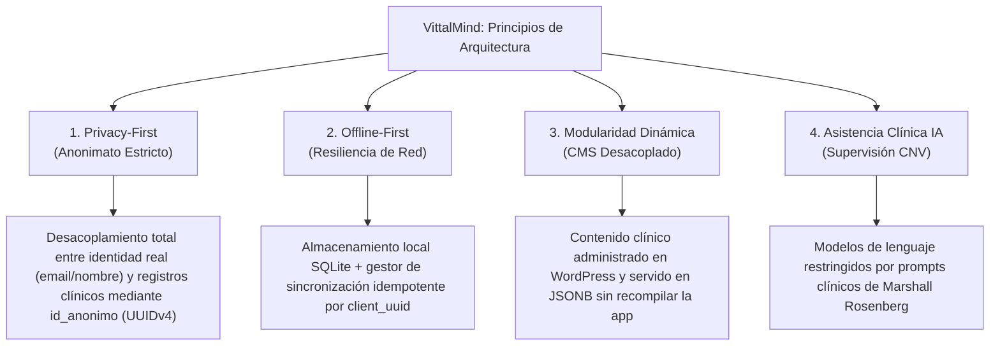

### 1.1. Principios Fundamentales
1. **Seguridad y Privacidad Estricta (Patrón de Anonimato):** Los datos clínicos (diarios, hitos de ánimo, gratitud, cuestionarios) **nunca** se vinculan a la identidad real del usuario (nombre, email). Toda la interacción transaccional viaja y se almacena bajo un identificador pseudo-aleatorio único: `id_anonimo` (`UUIDv4`).
2. **Arquitectura Offline-First:** Las herramientas críticas (Timeline, Gratitud, Botón de Pánico, lecturas descargadas) funcionan con o sin conectividad celular/Wi-Fi, almacenando datos localmente en SQLite y sincronizándolos de forma idempotente al restablecerse la red.
3. **Modularidad Dinámica:** Los contenidos psicoeducativos no están cableados en la aplicación móvil. Son servidos por el backend desde bases de datos relacionales y administrados por terapeutas mediante un plugin especializado en WordPress.
4. **Asistencia Supervisada por IA:** Las herramientas de Inteligencia Artificial (ej. Traductor Asertivo basado en Comunicación No Violenta - CNV) aplican una estricta sanitización de prompts para evitar respuestas diagnósticas o reactivas, garantizando un enfoque exclusivamente psicoeducativo.

---

## 2. ARQUITECTURA GENERAL DEL SISTEMA

El sistema opera bajo una **arquitectura desacoplada en tres capas principales**, complementada por microservicios en la nube y sincronizadores de contenido:

```mermaid
graph TB
    subgraph "Capa de Presentación (Frontend Móvil)"
        UI["React Native 0.86 / Expo SDK 57<br/>TypeScript"]
        NAV["Navegación Stack / Modales<br/>@react-navigation"]
        STORE["Almacenamiento Local Seguro<br/>expo-secure-store & expo-sqlite"]
        SYNC["SyncManager<br/>(Encolamiento Idempotente)"]
        GEO["Ubicación Pasiva en Memoria<br/>expo-location (Sin persistencia)"]
    end

    subgraph "Capa de Negocio y API (Backend)"
        API["Node.js 20 LTS / Express 4.21<br/>TypeScript API RESTful"]
        SEC["Middlewares de Seguridad<br/>Helmet, CORS, JWT Auth, RLS"]
        CTRL["Controladores REST<br/>Auth, Gratitud, Timeline, Psicoeducación"]
        SVC["Servicios de Dominio<br/>Lógica de Negocio y Validación"]
        REPO["Repositorios de Persistencia<br/>Consultas SQL Parametrizadas"]
    end

    subgraph "Capa de Persistencia y Datos"
        DB[("PostgreSQL 15+ (Supabase Cloud)<br/>SSL Forzado, Pool de Conexiones, RLS Activo")]
    end

    subgraph "Servicios Externos y Satélites"
        LLM["Proveedores de IA<br/>OpenRouter / Groq / OpenAI"]
        PUSH["Expo Push Notification Services"]
        CMS["WordPress CMS + Plugins Especializados<br/>(vittalmind-psicoeducacion & notificaciones)"]
        AUTH_EXT["Proveedores OAuth 2.0<br/>Google Cloud Platform & Apple Developer"]
    end

    UI --> NAV
    UI --> STORE
    STORE <--> SYNC
    UI --> GEO
    
    UI -->|HTTPS / REST / JWT Bearer| API
    SYNC -->|Batch Sync Idempotente| API
    
    API --> SEC --> CTRL --> SVC --> REPO --> DB
    
    SVC -->|Tokens OAuth| AUTH_EXT
    SVC -->|Prompts CNV (JSON REST)| LLM
    SVC -->|Push Tokens| PUSH
    CMS -->|Gestión Contenidos / Migración| DB
```

---

## 3. DIAGRAMA DE CASOS DE USO (ACTORES Y SISTEMA)

El sistema distingue tres actores principales:
- **Usuario / Paciente:** Persona que busca gestionar su salud mental, registrar su día a día y acceder a recursos clínicos.
- **Profesional / Terapeuta:** Terapeuta avalado registrado en el directorio para vinculación y contacto.
- **Administrador Clínico / Psicólogo CMS:** Co-autor o terapeuta autorizado para publicar manuales, lecturas y notificaciones.

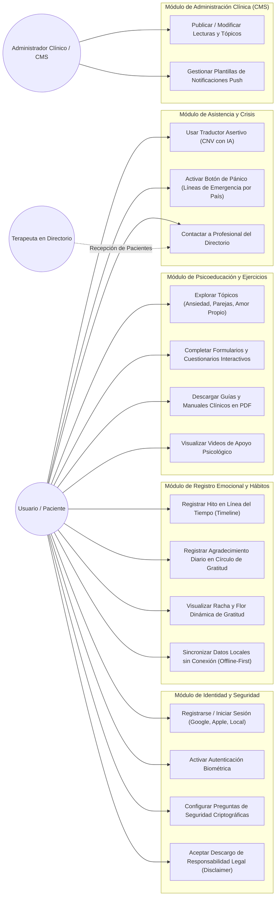

---

## 4. DIAGRAMA DE BASE DE DATOS (ENTITY-RELATIONSHIP DIAGRAM - ERD)

A continuación se muestra el modelo relacional de la base de datos de producción (PostgreSQL), que implementa el **patrón de disociación de identidad**:

```mermaid
erDiagram
    USUARIOS_AUTH ||--o{ REFRESH_TOKENS : "emite"
    USUARIOS_AUTH ||--o{ PREGUNTAS_SEGURIDAD : "protege con"
    USUARIOS_AUTH ||--o{ TIMELINE_EVENTS : "crea (via id_anonimo)"
    USUARIOS_AUTH ||--o{ GRATITUDE_ENTRIES : "escribe (via id_anonimo)"
    USUARIOS_AUTH ||--o| GRATITUDE_STREAKS : "acumula (via id_anonimo)"
    USUARIOS_AUTH ||--o{ USUARIO_PROGRESO_PSICOEDUCACION : "avanza (via id_anonimo)"
    USUARIOS_AUTH ||--o{ NOTIFICATION_DEVICES : "vincula (via id_anonimo)"
    USUARIOS_AUTH ||--o| NOTIFICATION_PREFERENCES : "configura (via id_anonimo)"

    CATEGORIAS_PSICOEDUCACION ||--o{ TEMAS_PSICOEDUCACION : "contiene"
    TEMAS_PSICOEDUCACION ||--o{ CONTENIDOS_BLOQUES : "desglosa en"
    CONTENIDOS_BLOQUES ||--o{ USUARIO_PROGRESO_PSICOEDUCACION : "evalua"

    USUARIOS_AUTH {
        int id_usuario PK
        string email UK "Email disociado"
        string password_hash "Bcrypt (NULL si Google/Apple)"
        string auth_provider "local | google | apple"
        string nombre_completo "Disociado de datos clinicos"
        uuid id_anonimo UK "UUIDv4 unico utilizado en sistema clinico"
        boolean acepto_disclaimer "Aceptacion legal"
        string role "user | admin"
        timestamp created_at
        timestamp updated_at
    }

    REFRESH_TOKENS {
        int id PK
        uuid id_anonimo FK "Referencia usuarios_auth(id_anonimo)"
        string token_hash "SHA256 del refresh token"
        timestamp expires_at "Expiracion 30 dias"
        boolean revoked "Bandera de revocacion"
        timestamp created_at
    }

    PREGUNTAS_SEGURIDAD {
        int id PK
        uuid id_anonimo FK "Referencia usuarios_auth(id_anonimo)"
        string pregunta "Texto de la pregunta"
        string respuesta_hash "Bcrypt de la respuesta saneada"
        timestamp created_at
    }

    TIMELINE_EVENTS {
        int id PK
        uuid id_anonimo "Referencia logica a id_anonimo"
        string client_uuid UK "UUIDv4 del dispositivo para idempotencia offline"
        string emoji "Icono de emocion"
        string emocion_label "Etiqueta descriptiva"
        text descripcion "Texto del hito o pensamiento"
        text sentimiento "Analisis reflexivo personal"
        timestamp fecha "Fecha del suceso"
        timestamp created_at
    }

    GRATITUDE_ENTRIES {
        int id PK
        uuid id_anonimo "Referencia logica a id_anonimo"
        string client_uuid UK "UUIDv4 para idempotencia offline"
        text texto "Reflexion diaria de agradecimiento"
        date fecha "Dia calendario registrado"
        timestamp created_at
    }

    GRATITUDE_STREAKS {
        int id PK
        uuid id_anonimo UK "Referencia logica a id_anonimo"
        int current_streak "Racha actual en dias"
        int best_streak "Mejor racha historica"
        date last_completed_date "Ultima fecha computada"
        timestamp created_at
        timestamp updated_at
    }

    CATEGORIAS_PSICOEDUCACION {
        int id PK
        string slug UK "Identificador URL"
        string titulo "Nombre de la categoria"
        text descripcion "Sintesis"
        string icono "Identificador visual"
        int orden "Secuencia de presentacion"
        timestamp created_at
    }

    TEMAS_PSICOEDUCACION {
        int id PK
        int categoria_id FK "Referencia categorias_psicoeducacion(id)"
        string titulo "Titulo del modulo"
        text descripcion_breve "Resumen"
        string autor "Nombre de autor / terapeuta"
        boolean exportar_pdf "Habilita exportacion documental"
        int orden "Secuencia"
        timestamp created_at
        timestamp updated_at
    }

    CONTENIDOS_BLOQUES {
        int id PK
        int tema_id FK "Referencia temas_psicoeducacion(id)"
        string pilar "CONCIENCIA | ACEPTACION | ACCION"
        string tipo_componente "TEXTO | TABLA_COMPARATIVA | CUESTIONARIO | EJERCICIO | FORMULARIO | VIDEO_YOUTUBE"
        string titulo_bloque "Encabezado"
        jsonb cuerpo_json "Estructura dinamica renderizada por la app"
        int orden "Posicion dentro del pilar"
        timestamp created_at
        timestamp updated_at
    }

    USUARIO_PROGRESO_PSICOEDUCACION {
        int id PK
        uuid id_anonimo "Referencia logica a id_anonimo"
        int bloque_id FK "Referencia contenidos_bloques(id)"
        jsonb respuestas_usuario_json "Respuestas y notas"
        boolean completado "Estado de finalizacion"
        timestamp actualizado_en
    }

    PROFESIONALES {
        int id PK
        string nombre "Nombre del terapeuta"
        string especialidad "Area clinica"
        text descripcion "Perfil academico y enfoque"
        string telefono "Numero de contacto"
        string email "Correo corporativo"
        boolean activo "Disponibilidad en catalogo"
        timestamp created_at
    }

    NOTIFICATION_DEVICES {
        bigint id PK
        uuid id_anonimo "Referencia logica a id_anonimo"
        string device_id "Identificador de hardware"
        string push_token UK "Token de Expo Push Services"
        string platform "ios | android"
        string app_version "Version del cliente"
        string locale "Idioma"
        string timezone "Huso horario del usuario"
        boolean push_enabled "Estado de recepcion"
        timestamp last_seen_at
    }

    NOTIFICATION_PREFERENCES {
        uuid id_anonimo PK "Referencia logica a id_anonimo"
        boolean enabled "Interruptor general"
        boolean gratitude_reminder_enabled "Recordatorio diario de gratitud"
        boolean motivation_enabled "Frases de bienestar"
        boolean announcements_enabled "Anuncios del sistema"
        time reminder_time_local "Hora programada"
        time quiet_hours_start "Inicio horario no molestar"
        time quiet_hours_end "Fin horario no molestar"
        string timezone
    }
```

---

## 5. DIAGRAMAS DE CLASES Y MODELOS (FRONTEND Y BACKEND)

### 5.1. Diagrama de Clases del Backend (TypeScript / Express Architecture)
El backend implementa un patrón **Controller - Service - Repository**:

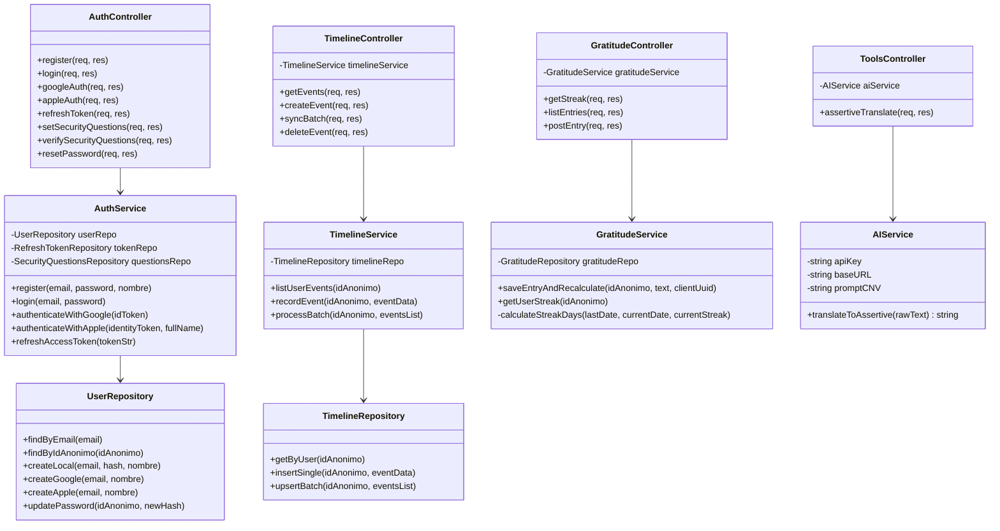

### 5.2. Diagrama de Clases y Módulos del Frontend (React Native / Expo Architecture)
El frontend implementa una arquitectura desacoplada basada en **Custom Hooks, Context API y Capa de Persistencia Local**:

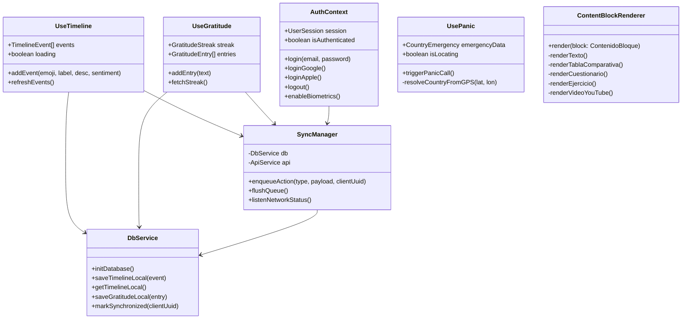

---

## 6. DIAGRAMAS DE FLUJO (PROCESOS CRÍTICOS DEL SISTEMA)

### 6.1. Flujo de Autenticación, Disociación de Privacidad y Biometría

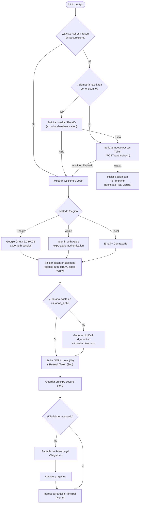

### 6.2. Flujo del Botón de Pánico y Manejo de Crisis (Privacidad Estricta de GPS)

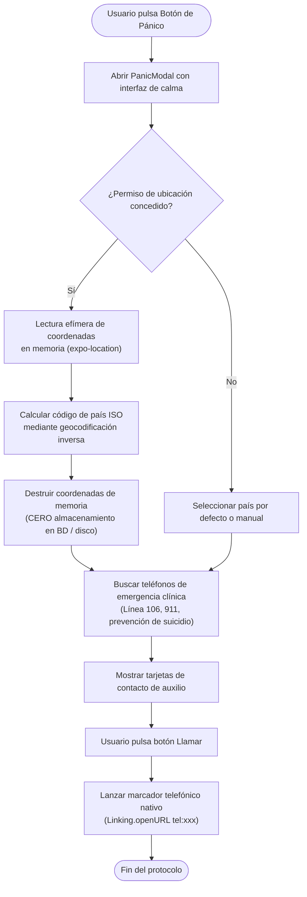

### 6.3. Flujo del Traductor Asertivo (Comunicación No Violenta - CNV)

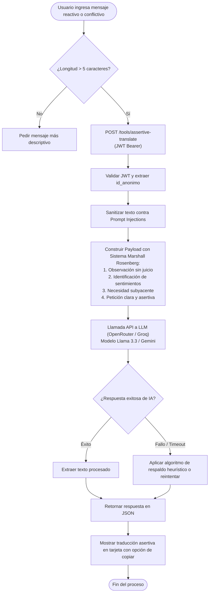

---

## 7. DIAGRAMAS DE SECUENCIA (INTERACCIONES CLAVE)

### 7.1. Secuencia de Sincronización Offline-First (Timeline y Gratitud)

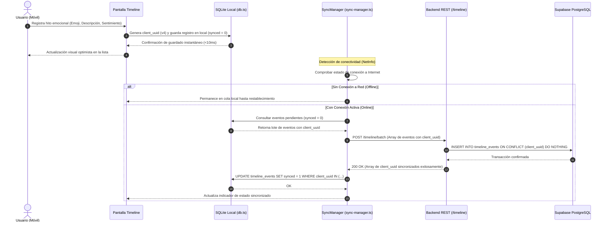

### 7.2. Secuencia de Consulta Dinámica de Psicoeducación (CMS Desacoplado)

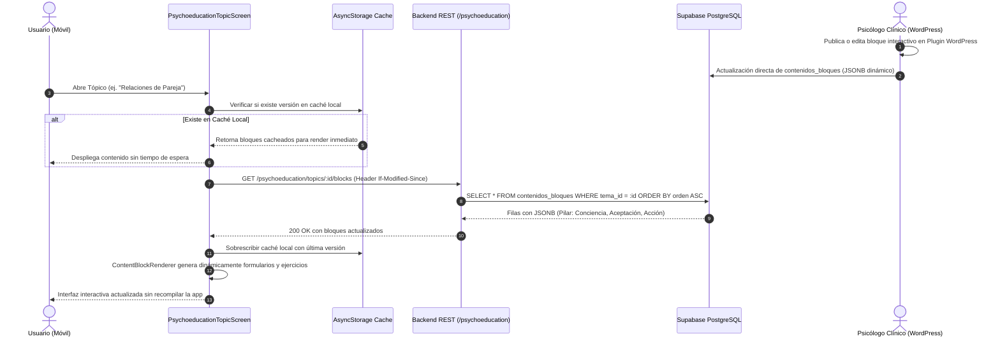

---

## 8. DISEÑO DE INTERFAZ Y EXPERIENCIA DE USUARIO (UI/UX)

### 8.1. Sistema de Diseño Visual y Paleta Cromática
La interfaz sigue una directriz de **baja estimulación visual**, diseñada para personas en estados de alta vulnerabilidad emocional, ansiedad o estrés.

| Elemento | Token / Valor Hex | Uso en el Sistema |
|---|---|---|
| **Fondo Principal** | `#FBF9F8` | Blanco cálido que disminuye el deslumbramiento y fatiga visual |
| **Superficie / Cards** | `#FFFFFF` | Contenedores con elevación sutil y bordes redondeados (`borderRadius: 16`) |
| **Texto Primario** | `#1C1917` | Gris carbón profundo para máximo contraste accesible |
| **Texto Secundario** | `#78716C` | Tono tierra suave para subtítulos y metadatos |
| **Acento Primario (Salvia)** | `#4A7C59` | Verde sereno que evoca naturaleza, calma y estabilidad |
| **Acento Secundario (Lavanda)** | `#7E6B8F` | Tono terapéutico para tópicos de reflexión y aceptación |
| **Alerta / Crisis** | `#C0392B` | Rojo reservado exclusivamente para el Botón de Pánico |
| **Tipografía** | System Font (San Francisco / Roboto) | Legibilidad nativa fluida en cualquier dispositivo |

### 8.2. Estructura de Navegación de la Aplicación

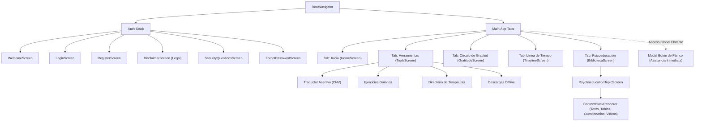

---

## 9. MATRIZ DE SEGURIDAD, PRIVACIDAD Y ESPECIFICACIÓN DE ENDPOINTS

### 9.1. Matriz de Endpoints de Producción (API RESTful)

| Módulo | Método | Endpoint | Autenticación | Descripción Funcional |
|---|---|---|---|---|
| **Auth** | `POST` | `/auth/register` | Pública | Registro de usuario local con hash Bcrypt. |
| **Auth** | `POST` | `/auth/login` | Pública | Login local; retorna Access Token y Refresh Token. |
| **Auth** | `POST` | `/auth/google` | Pública | Verificación de Google ID Token y vinculación con `id_anonimo`. |
| **Auth** | `POST` | `/auth/apple` | Pública | Verificación de Apple Identity Token y disociación de identidad. |
| **Auth** | `POST` | `/auth/refresh` | Pública | Rotación de Refresh Token para extender sesión sin reautenticar. |
| **Auth** | `POST` | `/auth/security-questions`| Bearer JWT | Configuración de preguntas de seguridad para recuperación. |
| **Timeline** | `GET` | `/timeline` | Bearer JWT | Consulta de hitos cronológicos asociados al `id_anonimo`. |
| **Timeline** | `POST` | `/timeline` | Bearer JWT | Creación individual de un hito emocional. |
| **Timeline** | `POST` | `/timeline/batch` | Bearer JWT | Sincronización idempotente de lote de eventos offline. |
| **Gratitud** | `GET` | `/gratitude/streak` | Bearer JWT | Obtención de días consecutivos y racha histórica del usuario. |
| **Gratitud** | `POST` | `/gratitude/entries` | Bearer JWT | Registro de gratitud del día y recalculo automático de racha. |
| **Psicoeducación**| `GET` | `/psychoeducation/categories` | Bearer JWT | Listado de categorías clínicas (Ansiedad, Pareja, etc.). |
| **Psicoeducación**| `GET` | `/psychoeducation/topics/:id` | Bearer JWT | Lectura de temas con sus bloques dinámicos y JSONB. |
| **Herramientas** | `POST` | `/tools/assertive-translate` | Bearer JWT | Procesamiento de comunicación asertiva asistida por IA. |
| **Profesionales** | `GET` | `/professionals` | Bearer JWT | Directorio de terapeutas activos para agendamiento. |
| **Sistema** | `GET` | `/app/version` | Pública | Control de versiones mínimas y obligatorias de tiendas. |
| **Salud** | `GET` | `/health` | Pública | Healthcheck de disponibilidad de base de datos y backend. |

### 9.2. Mecanismos de Ciberseguridad y Protección de Datos
1. **Row Level Security (RLS) en Supabase:**
   - La totalidad de las tablas en el esquema `public` tienen RLS habilitado.
   - El acceso anónimo público por PostgREST está denegado; las consultas transaccionales solo se efectúan mediante el pool seguro del Backend con rol de servicio autenticado.
2. **Hardening de Cabeceras HTTP:**
   - Implementación de `helmet` para protección contra Clickjacking (`X-Frame-Options`), inyección de contenido (`X-Content-Type-Options`) y Cross-Site Scripting (`X-XSS-Protection`).
3. **Criptografía de Contraseñas y Respuestas de Seguridad:**
   - Hashing mediante `bcrypt` con factor de coste de 10 rondas de salt para contraseñas locales y respuestas a preguntas de recuperación.
4. **Almacenamiento Local Cifrado:**
   - En el dispositivo móvil, los tokens de sesión sensibles se almacenan en el hardware de seguridad mediante `expo-secure-store` (Keychain en iOS y EncryptedSharedPreferences en Android).
5. **Sanitización de Datos de Ubicación:**
   - Las coordenadas GPS utilizadas para mapear los números de emergencia en el Botón de Pánico se mantienen **únicamente en la memoria volátil (RAM)** de la app móvil mientras el modal está abierto, y se destruyen inmediatamente. Ninguna coordenada es transmitida a la red ni guardada en bases de datos.

---

## 10. CONCLUSIONES Y TRANSFERIBILIDAD TÉCNICA

La arquitectura de VittalMind descrita en este documento representa un producto maduro, estable y probado en producción (rama `main`), caracterizado por:
1. **Escalabilidad Horizontal:** Separación completa entre Frontend móvil, API RESTful stateless y PostgreSQL relacional.
2. **Independencia Operativa:** Capacidad de actualizar contenidos clínicos y psicoeducativos en tiempo real mediante CMS sin depender de ciclos de aprobación en App Store o Google Play.
3. **Cumplimiento Normativo de Privacidad:** Preparado arquitectónicamente para normativas de datos de salud y privacidad estricta (tipo HIPAA/GDPR) gracias a la total disociación entre credenciales reales y datos clínicos.
4. **Bajo Costo de Mantenimiento:** Stack altamente estandarizado (TypeScript en toda la solución) con bibliotecas permisivas de código abierto sin dependencias de licencias de pago obligatorias.

